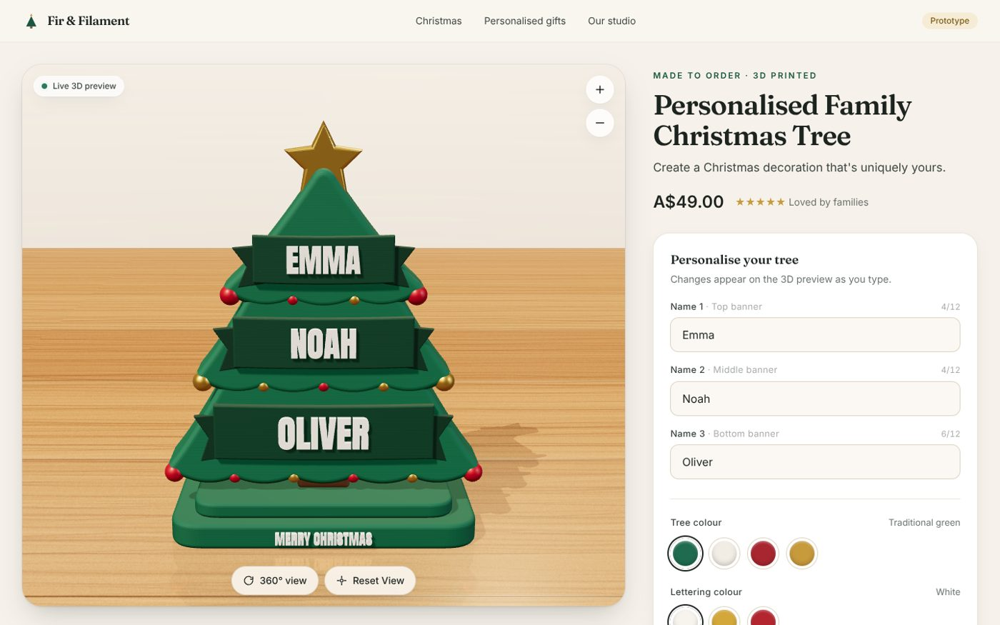
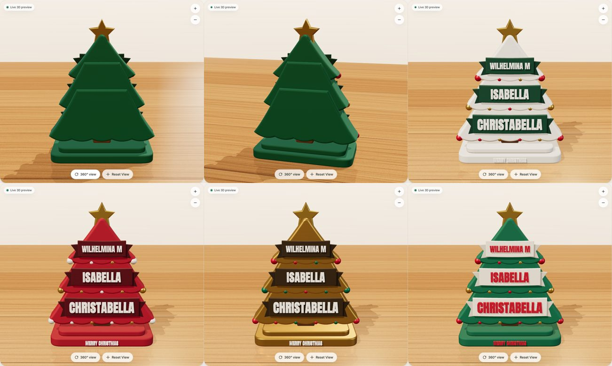
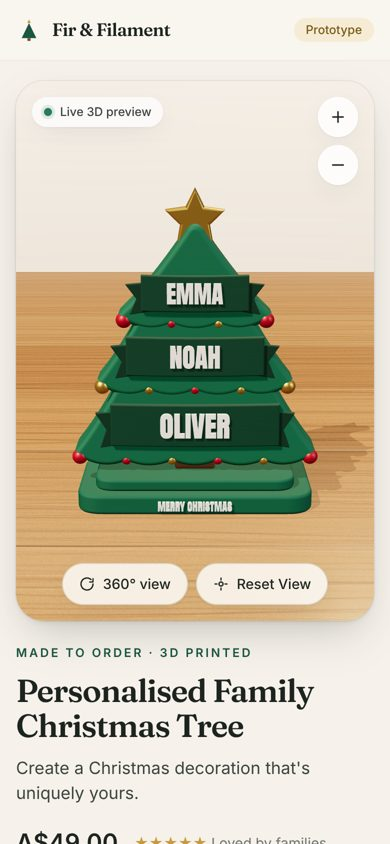

# Christmas Tree Personaliser

A proof-of-concept product page where a customer personalises a 3D-printed tabletop Christmas tree (about 18 cm tall). Every change updates a real-time 3D model straight away.



| Colours, side and back views | Mobile |
| --- | --- |
|  |  |

## What it does

- **Procedural 3D product.** The tree is built entirely in code: three layered fir tiers with scalloped hems and bevelled edges, a trunk, a two-step plinth with raised "MERRY CHRISTMAS" lettering, baubles and a silk-gold star. All parts are solid geometry, so the back and sides look like a real object.
- **Live names.** Each of the three names becomes extruded, bevelled 3D lettering (the OFL-licensed Anton typeface) on a ribbon banner. The geometry is rebuilt on each keystroke and shrinks automatically so long names stay inside their banner. Names can be up to 12 characters, the top banner is Name 1, and the camera doesn't move while you type.
- **Colours.** Tree colour (Traditional green, Snow white, Berry red, Silk gold) and lettering colour (White, Gold, Red) update the existing materials straight away. The banner plate colour changes with them so the names stay readable. For example, red lettering sits on an ivory banner.
- **Viewer.** Drag or swipe with one finger to rotate 360°. Scroll or pinch to zoom, or use the +/− buttons. There's also a smooth "360° view" spin and a Reset View button. Panning is turned off and the camera can't go below the table. While you interact with the viewer, the page doesn't scroll (`touch-action: none`).
- **Tabletop set.** A procedural oak tabletop with a soft blurred reflection, a warm window key light with soft shadows, contact shadows and a studio backdrop. Reflections come from an environment built out of in-scene light panels, so no HDR files are downloaded.
- **Shop page.** A two-column desktop layout (about 65% viewer, 35% controls). On mobile the viewer comes first and the controls stack underneath. The "Your Design Is Ready" button opens a summary of the names and colours. There's no checkout or payment.

## Tech

React 18, Vite 5, TypeScript, Three.js, React Three Fiber, @react-three/drei (CameraControls, Environment/Lightformer, MeshReflectorMaterial, ContactShadows, RoundedBox) and Tailwind CSS. Fonts are self-hosted from npm (`@fontsource`). It has no backend and needs no API keys or network access at runtime.

## Run it

```bash
cd christmas-tree-personaliser
npm install
npm run dev          # http://localhost:5173
```

Production build: `npm run build && npm run preview`.

## Tests

`scripts/e2e.mjs` drives the running app with Playwright and saves screenshots to `test-results/`. It checks:

- the 3D names update for each input
- the camera holds its position while typing
- long names shrink to fit
- the 12-character limit
- mouse-drag rotation and the full 360° spin
- the back view
- wheel and button zoom
- Reset View
- every colour option
- the design summary
- Reset Personalisation
- the mobile layout, touch rotation and scroll locking
- the console has no runtime errors

```bash
npm i -D playwright && npx playwright install chromium   # one-off, if not already available
npm run dev            # in one terminal
npm run test:e2e       # in another
```

For testing, the scene exposes read-only state on `window.__treeDebug` (the names it actually rendered, with their size and width in cm) and `window.__viewerDebug` (camera azimuth and distance).

## Project layout

```
src/
  App.tsx                    product page and state
  config/options.ts          default names, colour options, price
  components/                Viewer overlay, colour picker, design summary modal
  three/Scene.tsx            canvas, lights, environment, camera controls
  three/ChristmasTree.tsx    assembles the tree and applies materials
  three/geometry.ts          procedural shapes and dimensions (cm)
  three/NameText.tsx         auto-fitting extruded 3D lettering
  three/Tabletop.tsx         wooden table and backdrop
  three/textures.ts          procedural wood, layer-line and backdrop textures
  assets/anton.typeface.json generated by scripts/build-font.mjs from @fontsource/anton
```

## Limitations

- The model is a visual preview only. It isn't checked for printability and there's no STL export.
- Names are shown in upper case. Only characters in the Anton Latin subset are supported (A–Z, digits, common punctuation and Latin-1 accents); any other character is left out.
- The texture of the printed layers is a stylised bump map, not real layer geometry.
- Reflections on the table are turned off on narrow screens to keep phones running smoothly.
